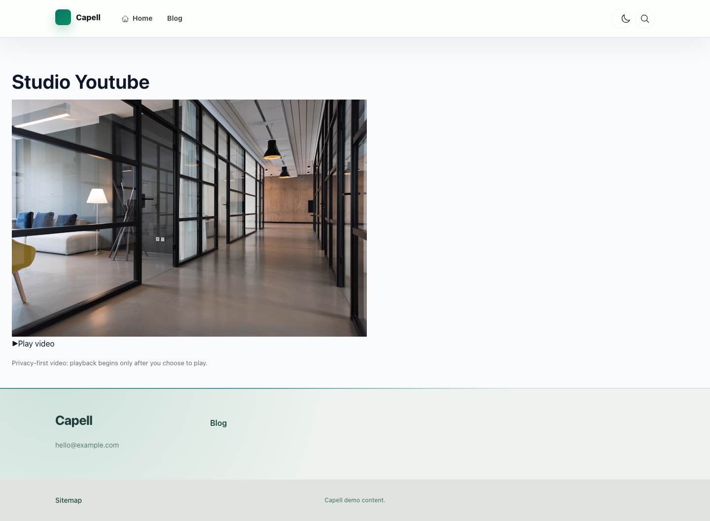
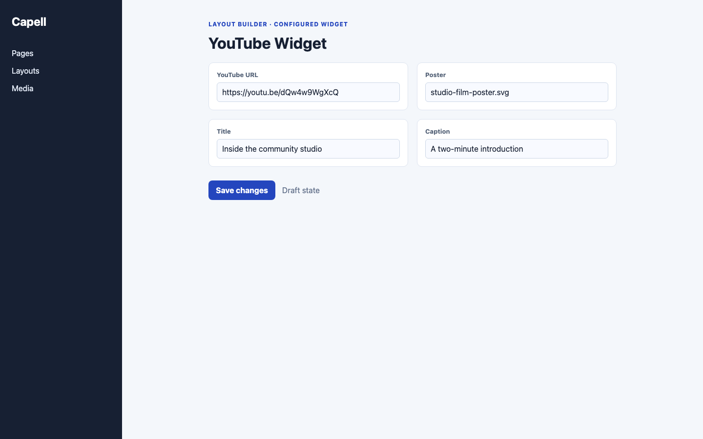

# YouTube Widget

<!-- prettier-ignore-start -->

## What This Plugin Adds

YouTube Widget is an **Available**, **No schema impact** Capell package in the **Capell Foundation** product group. It ships as `capell-app/widget-youtube` and extends these surfaces: admin, frontend.

YouTube adds a Layout Builder widget with a local poster and a youtube-nocookie.com player that is requested only after visitor activation. Privacy Center decisions can keep the external player blocked.

Editors configure the video and poster in Layout Builder, while visitors first see local public output and choose whether to load the external player.

Status details:

- Status: Available
- Tier: free
- Bundle: foundation
- Composer package: `capell-app/widget-youtube`
- Namespace: `Capell\WidgetYouTube`
- Theme key: not applicable

## Why It Matters

**For developers:** The extension registers its interaction assets while tests verify that initial HTML contains no YouTube request target and that denied privacy state remains blocked.

**For teams:** Teams can offer embedded video without making an external YouTube request part of the initial page response.

## Screens And Workflow

Screenshot contract: `docs/screenshots.json`.

- YouTube Widget extension card (marketplace, supplementary documentation fixture).
- YouTube fields in Layout Builder (admin, supplementary evidence).
- Youtube public output (frontend, required evidence).
- YouTube fields in Layout Builder with admin sidebar menu open (admin, supplementary evidence).

## Technical Shape

### Service providers

- `Capell\WidgetYouTube\Providers\WidgetYouTubeServiceProvider`

### Filament classes

- `YouTubeVideoIdField`
- `YouTubeWidget`

### Data objects

- `YouTubeInputData`
- `YouTubeRenderData`

### Manifest contributions

- `asset: Capell\WidgetYouTube\WidgetYouTubeContribution`
- `content-widget: Capell\WidgetYouTube\WidgetYouTubeContribution`

### Health checks

- `Capell\WidgetYouTube\Health\WidgetYouTubeHealthCheck`

### Blade views

- `packages/widget-youtube/resources/views/widget.blade.php`

### Cache tags

- `widget-youtube`

## Data Model

This package has no schema impact. It extends Capell through `asset` contributions and `content-widget` contributions instead of declaring package-owned tables.

## Install Impact

- Required packages: `capell-app/admin`, `capell-app/core`, `capell-app/frontend`, `capell-app/layout-builder`.
- Admin navigation: no admin page or resource contribution is declared.
- Admin/editor extensions: `content-widget: WidgetYouTubeContribution`.
- Permissions: no package permission declarations or Shield gates detected; host access rules still apply.
- Public routes: none declared.
- Database changes: no package migrations declared.
- Config: no package config files.
- Settings: no package settings declared.
- Queues or schedules: none declared.
- Cache tags: `widget-youtube`.
- Commands: none declared.

## Common Pitfalls

- Keep required Capell packages on compatible v4 releases: `capell-app/admin`, `capell-app/core`, `capell-app/frontend`, `capell-app/layout-builder`.
- Keep public Blade and cached HTML free of authoring markers, model IDs, permissions, signed editor URLs, and lazy database queries.
- Custom write integrations must preserve invalidation for `widget-youtube` cache tags.

## Troubleshooting

| Symptom | Likely cause | Check | Fix |
| --- | --- | --- | --- |
| Package surface is missing after install | Provider or manifest is not loaded | Confirm `capell.json`, package `composer.json`, and provider registration | Reinstall the package, refresh Composer autoload, and clear host caches |
| Public output leaks unexpected state | Render data, cache variation, or authoring boundary has regressed | Check public Blade, cache tags, and public-output safety tests | Move data loading out of Blade and rerun the package public-output tests |

## Quick Start

1. Install the package: `composer require capell-app/widget-youtube`.
2. Open a host admin workflow that uses the package extension and verify YouTube Widget is available.

## Next Steps

- [Package docs](docs/README.md)
- [Overview](docs/overview.md)
- [Troubleshooting](#troubleshooting)
- [Screenshot contract](docs/screenshots.json)
- [Marketplace assets](docs/assets/marketplace/)
- [Capell content language plan](../../docs/CONTENT_LANGUAGE_PLAN.md)
- [Capell documentation design system](../../docs/DESIGN_SYSTEM.md)
- [Capell and package ERD notes](../../docs/erd/capell-and-package-erds.md)
- Related packages: [Layout Builder](../layout-builder/README.md), [Privacy Center](../privacy-center/README.md).

<!-- prettier-ignore-end -->
